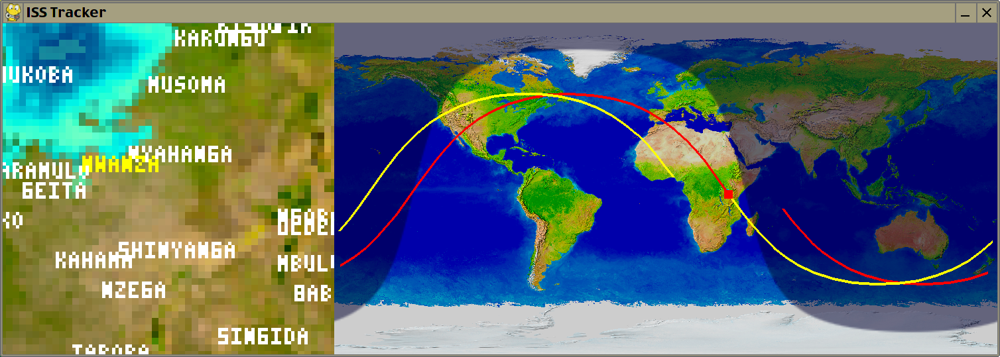

## A tracker for the International Space Station (ISS) in Python

iss2.py uses [Skyfield](https://rhodesmill.org/skyfield/) to calcuate the current ISS position and shows 90 minutes of the past (red) and future (yellow) ISS track. Orbital elements for today (from CelesTrak) are saved in stations.csv.

The zoomed-in map on the left of the PyGame window roughly corresponds to the downward
[NASA video feed](https://eol.jsc.nasa.gov/ESRS/HDEV/).
Note that the video feed lags a little behind the live map.

### Matplotlib scripts

The first two scripts output high-res PNG world maps (map.png and map2.png).
ISS positions are plotted at 20-second intervals over the next two hours.

* map.py (for [Basemap](https://matplotlib.org/basemap/))
* map2.py (for [Cartopy](https://scitools.org.uk/cartopy/))

There is also a script to show the current positions of *all* objects from stations.csv in an interactive Matplotlib window, updated every 3 seconds:

* all.py (for Basemap)

Press Ctrl-C in the terminal to quit.

### Screenshots

#### iss2.py (Skyfield)

### Credits

The place name database used for cities.png is from [Natural Earth](https://www.naturalearthdata.com/). The pixel font is [Bit 5x3](https://www.mattlag.com/bitfonts/).

